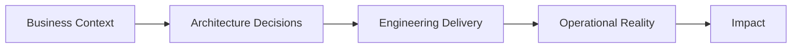

  

# Design for change. Engineer for reality.

### Enterprise transformation · integration · cloud · engineering

---

## Architecture with engineering depth

I work where **business goals, system design, and implementation reality** meet.

With **16 years in technology**, including **10 years in Solution Architecture**, I focus on **enterprise transformation, integration, cloud adoption, and modernization** across **banking and telecom**. Alongside architecture leadership, I keep my engineering depth current through independent technical labs in **distributed systems, Java backends, cloud-native design, and applied AI**.

> *Good architecture is not just what looks elegant on a diagram — it is what still works when systems scale, dependencies fail, and trade-offs become real.*

## What I bring

- **Enterprise architecture** — target and transition architecture, solution shaping, and reusable patterns
- **Integration & distributed systems** — APIs, event-driven architecture, workflow, and resilient system boundaries
- **Cloud & modernization** — AWS, hybrid-cloud thinking, migration choices, serverless, and operational readiness
- **Architecture leadership** — design assurance, technical direction, stakeholder alignment, and mentoring

## How I think

## Architecture notebook

This GitHub profile is my public space for **architecture notes, technical labs, and engineering explorations**.

The focus is simple:
- make trade-offs explicit,
- stay close to implementation,
- and use hands-on work to validate ideas.

**Current themes:** event-driven systems · cloud-native engineering · modernization patterns · AI-enabled architecture

[**Explore repositories →**](https://github.com/manuonsky?tab=repositories)

## Technology toolkit

### Core stack

### Platforms & development

### Data & integration

### Operations & delivery

## Credentials

-7C3AED?style=flat-square)

## GitHub snapshot

---

### Ideas → Architecture → Impact

**Enterprise mindset. Engineering depth. Continuous learning.**

