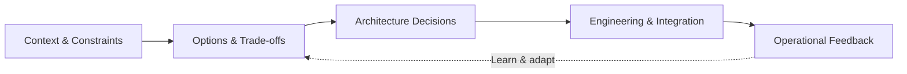

<!--
  GitHub profile README for github.com/manuonsky.
  Keep repository claims evidence-based: the seven upcoming repositories are README-first.
  Once published, replace the general repository link with selected real repository URLs.
  Third-party banner/stats services may occasionally be unavailable.
-->

### SOLUTION ARCHITECTURE × HANDS-ON ENGINEERING

**Enterprise Modernization** &nbsp;•&nbsp; **Cloud & Integration** &nbsp;•&nbsp; **Distributed Systems** &nbsp;•&nbsp; **Applied AI**

## The thinking behind the systems

> **Architecture isn't the diagram. It's the decisions that continue to make sense when systems scale, dependencies fail, and requirements change.**

I work at the intersection of **solution architecture and engineering**—translating business needs into practical designs for modernization, integration, cloud platforms, and AI-enabled solutions. I stay close to implementation through independent work with **Java, Spring Boot, and AWS**.

| **Shape the direction** | **Design the boundaries** | **Understand the reality** |
| :--- | :--- | :--- |
| Enterprise architecture, modernization, technology choices | APIs, event-driven systems, cloud integration | Reliability, security, trade-offs, maintainable engineering |

## My architecture lens

*An approach to designing systems—not a claim about a particular deployed architecture.*

## Architecture field notes

**Seven documentation-first repositories are on the way.** Each is intended to make one architectural idea easier to examine: the problem, the design, the alternatives, the failure modes, and the engineering implications.

**Focus:** distributed systems · backend engineering · cloud-native patterns · event-driven integration · applied AI

[**Explore the repositories →**](https://github.com/manuonsky?tab=repositories)

<!--
  When the seven repositories exist, add 3–5 selected links here with their actual URLs.
  Suggested style:
  [Architecture Study Title](https://github.com/manuonsky/actual-repo) — key question · Design study
  Do not imply an implemented or validated system when a repo only contains documentation.
-->

## Technology landscape

Technologies used across professional interests and independent exploration; not all are used in every repository.

**Cloud & infrastructure**

**Backend, web & APIs**

**Data & eventing**

**Engineering & delivery**

**Observability & search**

## Beyond the diagrams

🔭 **Working on:** enterprise architecture, modernization, cloud integration, and independent engineering projects  
🌱 **Exploring:** cloud-native system design and applied AI/ML through hands-on work and an M.Sc. in AI & ML  
🤝 **Open to:** architecture discussions and open-source collaboration in distributed systems, backend engineering, and practical AI

## GitHub signals

Live third-party widgets show GitHub activity, not professional experience or delivery impact.

---

### Think in systems. Design for change. Build with purpose.

[LinkedIn](https://www.linkedin.com/in/manoj-parambil/) · [GitHub](https://github.com/manuonsky) · [Architecture field notes](https://github.com/manuonsky?tab=repositories)

